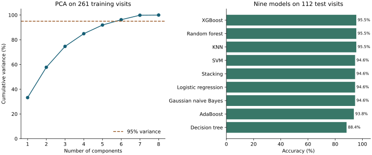

# What does 95% accuracy tell us about dementia?

*Mingpu (Andy) Wu · Indian Springs School research project*

When I compared nine machine-learning models in high school, three of them finished with the same test accuracy. Logistic regression, naïve Bayes and XGBoost each reached 95% on my poster. I singled out XGBoost because its reported F1 score, which balances precision and recall, was also 0.95. Revisiting the project, the number I find most informative is 112. That was the number of visits in the test set. To understand what 95% meant, I had to ask what the model knew about those visits before it made a prediction. [Original poster](poster/Original-poster.pptx)

My starting point was the longitudinal OASIS dataset. Each row described a visit. It combined measurements derived from a brain scan, such as normalized whole-brain volume, with information collected in the clinic, including a cognitive test score. I used Python to explore how the variables related to one another, then compared methods ranging from logistic regression to ensembles of decision trees. I used principal component analysis to ask how much of the variation in the measurements could be summarized in fewer dimensions. Boruta addressed a different question. Which measurements carried more information about the recorded group than randomly shuffled features? Four variables shared the highest rank on my poster, including the cognitive score and the Clinical Dementia Rating, or CDR.

Looking back, CDR was the feature that changed how I understood the result. OASIS researchers used that rating to characterize dementia. Giving it to a classifier meant that part of the clinical assessment was already available as an input. In a reconstruction using the same 112 held-out visits for both runs, XGBoost classified 107 visits correctly with CDR and 82 when I withheld it. Those 25 additional correct classifications tell me something the original model ranking could not. On this split, access to one clinical rating made a substantial difference. [OASIS study publication](https://doi.org/10.1162/jocn.2009.21407)

The repeated visits raised one more question. How would the model do on someone whose other visits it had never seen? For the renewal, I used one baseline visit per person and tested each participant once, with their data held out of training. The task was to distinguish a recorded CDR of zero from a rating above zero. XGBoost classified 129 of 150 people correctly with the cognitive score alone. Adding the two MRI measurements brought that count to 125. In this cohort, those two scan summaries added no observed accuracy. The original comparison taught me how to evaluate several models on the same data. Returning to it taught me to name the outcome, the information available at prediction time, and the people represented in the test set before interpreting any score.

*Written for this archive from the surviving poster and the renewed experiments. The Python reconstruction was developed with OpenAI Codex assistance. The original essay text, notebook, split assignments and model settings remain unavailable.*

## Explore the reconstructed code

[Poster analysis](poster_analysis.py) rebuilds the training-set correlations, PCA curve, Boruta rankings, and nine-model train/test comparison. [Participant-level analysis](analyze.py) runs the follow-up experiments. The first analysis matches the poster's named steps using documented assumptions. Its feature-selection settings and split are reconstruction choices.



## What the renewal found

The historical XGBoost matrix contains 106 correct classifications in 112 test visits. The new run came within one classification of that count when it used CDR and the other three top-ranked inputs. Seventy participants appeared on both sides of the reconstructed visit split. The original notebook and split assignments were lost, so the close counts do not establish that the original experiment was reproduced exactly.

| XGBoost evaluation | Correct | Accuracy | Positive-class F1 |
| --- | ---: | ---: | ---: |
| Historical poster, as reported | 106/112 | 95% (rounded) | Averaging unspecified; reported F1 0.95 |
| Reconstructed visit split, with CDR | 107/112 | 95.5% | 0.952 |
| Same visit split, withholding CDR | 82/112 | 73.2% | 0.694 |

For a second experiment, I used one baseline visit per person and asked whether the inputs could distinguish a recorded CDR of zero from a rating above zero. Each person was held out once in five-fold cross-validation. XGBoost classified **125/150 (83.3%)** correctly with the cognitive score and both MRI measurements, **129/150 (86.0%)** with the cognitive score alone, and **74/150 (49.3%)** with the two MRI measurements alone. Always choosing the training majority classified 85/150 correctly. In this sample, adding those two MRI summaries to MMSE did not improve XGBoost's accuracy. These experiments evaluate recorded dementia ratings within one cohort. They do not establish a clinical diagnosis or predict who will develop Alzheimer's disease.

## Reproduce the analysis

The Python code was written anew with OpenAI Codex assistance. The published run used Python 3.13.9. From the repository root, run the following commands in a Python environment:

```sh
python -m pip install -r requirements.txt
python get_data.py
python poster_analysis.py data/oasis_longitudinal.csv
python analyze.py data/oasis_longitudinal.csv
```

The downloader verifies the pinned public CSV. An existing local copy can be supplied directly to `analyze.py`. The output contains aggregate metrics for nine model families and a majority baseline under five conditions. The original presentation and its transcribed table are in [poster/](poster/). The dataset attribution, assumptions and limitations are in [METHODS.md](METHODS.md). All renewed results are in [results/reanalysis.csv](results/reanalysis.csv).
